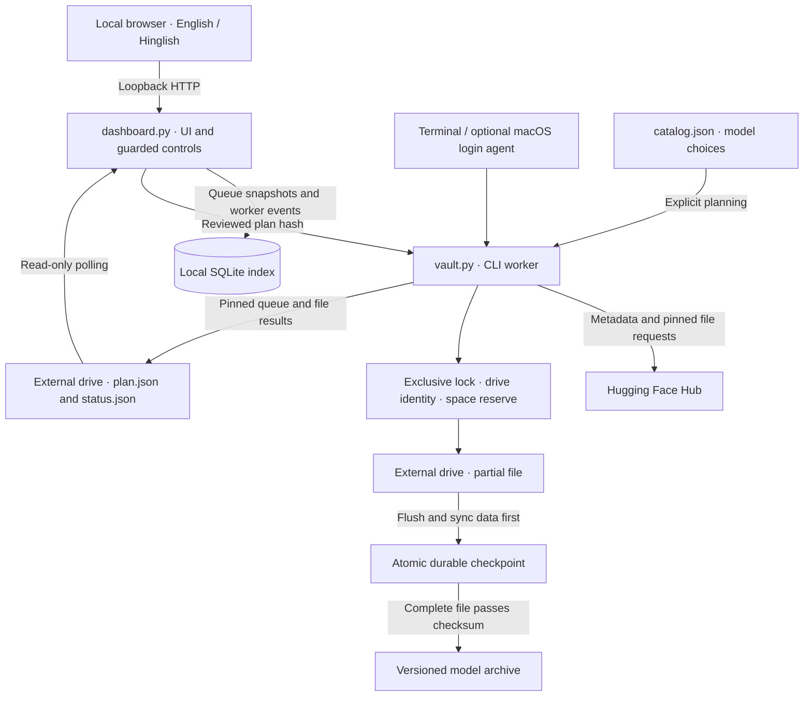

# Model Vault 2.0

**Created by Vipul** · [GitHub](https://github.com/pksvv)

**Save the models. Keep the context. Build your own AI library.**

Model Vault is a local-first archive for selected Hugging Face model releases. It combines a reviewable download queue, checksum verification, durable checkpoints, and a web dashboard, with model data stored on an external drive.

I built this around a simple idea: **if a model matters to your work, preserve a usable copy while you can access it.**

## Why I built this

A repository link is convenient, but it is not a backup. A publisher can remove a release, change access conditions, reorganize a repository, or stop maintaining a particular version. An internet connection, account, or hosted service may also be unavailable when you need it.

I wanted a personal model library that preserves more than a list of names. Model Vault saves selected weights together with available model cards, licenses, tokenizer/configuration files, and planning-time repository metadata. Each queue pins exact upstream commits so that “the model I used last time” can mean a specific version.

This is preservation with a purpose: keep useful building blocks for future projects, offline experiments, comparisons, and repeatable workflows. It is a curated archive rather than an attempt to download the entire model ecosystem.

## Why local models are useful

Local models let you decide where inference happens and which version runs. With a compatible local runtime and the required files, useful applications include:

| Use case | What a local model can contribute |
|---|---|
| Personal knowledge assistant | Summarize and search your notes or documents without sending their contents to a hosted inference API. |
| Coding companion | Explain code, draft tests, suggest changes, and assist with repository exploration. |
| Offline writing and study | Draft, rewrite, translate, explain concepts, and practice questions when connectivity is limited. |
| Document workflows | Extract structured information, classify text, and organize collections. |
| Private search | Use embeddings and a reranker to retrieve relevant passages before generating an answer. |
| Speech and image workflows | Transcribe audio or interpret images with appropriate models and supporting runtimes. |
| Repeatable experiments | Keep a known model revision and compare prompts, settings, or model variants against it. |

These are applications you can build around the archive. **Model Vault itself downloads and preserves assets; it does not yet provide chat, inference, document search, or transcription.**

Running inference locally can reduce dependence on per-request services and give you more control over data flow. It still has costs: hardware, electricity, storage, setup, and maintenance. Privacy also depends on the runtime and integrations you choose; a local model does not automatically make an entire application offline or private.

## My view of the future

My working belief is that local AI will become an increasingly important part of personal computing: assistants close to your files, specialized models for everyday tasks, and tools you can keep using on your own hardware.

The ambition is simple: **AI should be something you can run and retain, as well as something you can access as a service.** A well-kept local library gives us a foundation for that future.

That is a direction I am building toward, not a guarantee that every workload will move on-device. Cloud services can remain valuable for larger models, demanding tasks, shared infrastructure, and managed operations. A practical future may combine local models for everyday or private work with cloud models where they add value.

## Understanding model classifications

A model has several independent characteristics. **Purpose, behavior, lineage, packaging, and license are different dimensions.** A model can be a coding assistant, an abliterated derivative, and a quantized GGUF at the same time.

### 1. Purpose: what it is intended to do

| Classification | Meaning |
|---|---|
| General | Broad assistance such as chat, writing, summarization, and explanations. |
| Reasoning | Intended for multi-step problems. The label does not guarantee correct reasoning or answers. |
| Coding | Focused on programming tasks such as code generation, explanation, and editing. |
| Vision / multimodal | Processes images alongside text, subject to runtime and supporting-file requirements. |
| Embedding | Produces vector representations for tasks such as semantic search and clustering. |
| Reranker | Reorders retrieved candidates by their relevance to a query. |
| Speech | Supports audio tasks such as transcription, depending on the model. |

### 2. Behavior: how it has been tuned or modified

| Classification | Meaning |
|---|---|
| Base / pretrained | A starting model before instruction/chat tuning; it may need different prompting or further adaptation. |
| Instruct / chat | Tuned to follow instructions or participate in conversations. |
| Uncensored | A publisher/catalog label for a fine-tune intended to have fewer content restrictions. It is not a standardized guarantee. |
| Abliterated | Modified to reduce refusal behavior. It describes a modification approach, not a task specialty or quality rating. |

“General” does not tell you whether a model refuses a request. “Uncensored” and “abliterated” are not interchangeable, and neither means a model is more accurate, universally unrestricted, or exempt from its license. Evaluate behavior and quality on your actual tasks.

In the starter catalog, **Dolphin3.0-Llama3.1-8B** is labeled *Uncensored fine-tune*, while **mlabonne_Qwen3-8B-abliterated** is labeled *Abliterated*. Dashboard badges expose the catalog labels; they are not independent behavioral test results.

### 3. Lineage and publisher: where it comes from

A model family or base-model creator is different from the repository publisher. Qwen, Llama, and DeepSeek names can identify model lineage; a repository owner such as `bartowski` or `unsloth` may publish a packaged or quantized derivative.

The dashboard’s **Publisher** filter means the **Hugging Face repository owner**, not necessarily the original model creator. A distilled model is derived through a training process intended to transfer capabilities; an adapter is an additional set of weights that may require a separate base model. Model Vault does not automatically obtain an adapter’s base model.

### 4. Packaging: what you download

| Term | Meaning |
|---|---|
| GGUF | A model file format used by compatible inference runtimes. |
| Native / safetensors | Tensor assets in the repository’s native packaging; runtime compatibility still needs checking. |
| Quantization, such as Q4_K_M | A reduced-precision representation that trades storage/memory footprint against fidelity and runtime behavior. |
| Shards | Pieces of one larger model. A complete model may require all selected shards. |
| Vision projector / mmproj | A supporting asset that some vision runtimes need alongside the language model. |
| Pinned revision | The exact repository commit selected in the plan. It keeps the queue tied to a specific release. |

A smaller download is not automatically the best model for your task. Disk capacity, RAM, context length, runtime support, and acceptable output quality all matter. **A model fitting on the external drive does not mean it fits in the Mac’s RAM.**

### 5. Access and license: what you may do with it

Open-weight does not automatically mean open-source or unrestricted use. Gated access, commercial terms, redistribution conditions, and other requirements vary by model. Read the actual model card and license. A local copy preserves access to files; it does not override their terms.

## What Model Vault provides

- **Review before transfer:** exact revisions, filenames, sizes, and hashes in a pinned plan.
- **Visible classifications:** badges and clickable counts by category, publisher, download status, format, and license.
- **Resumable transfers:** partial files and durable checkpoints survive process interruption.
- **Integrity checks:** SHA-256 for LFS assets or Git blob SHA-1 for ordinary Git files before completion.
- **Drive protection:** mount/identity checks, one active manager, and a default 20 GiB space reserve.
- **Persistent queue index:** SQLite snapshots and dashboard worker history, including a saved queue view when the drive is offline.
- **Local web interface:** a light turmeric/red theme, English by default, and a remembered English/Hinglish switch.
- **Built-in help:** purpose, storage locations, terminology, controls, and recovery workflow.

Model Vault does not run downloaded code, install an inference engine, accept gated terms for you, automatically update model versions, or delete old models to make room.

## Architecture



The browser controls a separate CLI worker. SQLite is a local index for visibility and persistence; the external drive's pinned plan and checkpoints determine actual transfers. No inference engine or cloud application backend is part of this architecture.

## Tech stack and software requirements

| Component | Technology / requirement |
|---|---|
| Downloader and dashboard | Python **3.10+**; the dashboard uses the standard-library HTTP server. |
| Network transfers | `requests>=2.32.3,<3`, installed in a virtual environment. |
| Queue index | SQLite through Python's built-in `sqlite3`; no database service required. |
| Interface | Plain HTML, CSS, and JavaScript; no Node.js build step or frontend framework. |
| Integrity and recovery | `hashlib`, filesystem syncs, atomic JSON replacement, and `fcntl` locking. |
| Background recovery | Optional macOS `launchd` login agent and `caffeinate`. |
| Supported application setup | **macOS**: drive setup uses `diskutil`, `/Volumes`, and macOS mount semantics. Linux/Windows are not currently supported end-to-end. |
| Browser | A modern browser with JavaScript; local storage remembers the language preference. |
| Connectivity | Internet access for planning and downloads; saved files remain on disk afterward. |
| Inference | A separately installed compatible runtime, if you want to run the archived models. |

## Hardware and storage requirements

These are application requirements and planning guidelines, not details of the author's hardware.

| Resource | For Model Vault | For running archived models later |
|---|---|---|
| CPU | A machine capable of running the supported Python/macOS environment. | Depends on runtime and acceptable speed; GPU acceleration may help but is not required by this downloader. |
| Memory | No model-sized RAM allocation is required for streaming transfers. A minimum RAM figure has not been benchmarked. | Budget for weights, runtime overhead, and the context/KV cache. File size alone is not a reliable RAM estimate. |
| Storage | A writable mounted external volume, space for selected files and partials, plus the default **20 GiB reserve**. Existing versions and invalid copies can require additional space. | Fast storage can improve loading; storage capacity does not replace RAM. |
| Filesystem | Must support the selected file sizes; FAT32's per-file size limit makes it unsuitable for many weight files. | Check the runtime's file and filesystem support. |
| GPU | **Not needed for downloading, indexing, or verification.** | Model/runtime dependent; choose it for your workload after testing. |
| Power and backup | Stable power and a second copy of important archives are useful; a UPS can reduce interruption risk. | The same storage and power considerations apply. |

Choose the model after considering available memory, context length, quantization, and the runtime. This repository does not claim that a particular model size will run on every computer.

## Open the dashboard

For the existing configured installation:

```bash
cd /path/to/local-models
.venv/bin/python -u dashboard.py --port 8766
```

Open [Dashboard](http://127.0.0.1:8766/) or [Help & workflow](http://127.0.0.1:8766/help).

The server listens on loopback only. Opening the page does not start downloads, generate a plan, or install a login service. UI assets are local. The language choice is stored in this browser; model identifiers, paths, and raw worker logs retain their original text.

## First-time setup and planning

Requires macOS, Python 3.10+, and an already-mounted writable external drive. Keep the project and its environment on the Mac; model files live on the external drive. Setup preserves existing drive contents and does not format the disk. Do not use `sudo`.

```bash
cd /path/to/local-models
bash setup.sh "/Volumes/ModelArchive"
```

Use the drive’s actual volume name. If a python.org installation has certificate errors, use its supplied certificate installation instructions.

Read [CATALOG.md](CATALOG.md), then edit `catalog.json` to enable the models you want. Public repositories generally need no token. For gated models, obtain access and accept the terms yourself on Hugging Face, then optionally log in:

```bash
.venv/bin/python vault.py login
```

The hidden prompt stores the token in the Mac’s owner-only configuration file. `HF_TOKEN` can override it. Tokens are not stored in model metadata or the dashboard queue index.

Generate a fresh plan:

```bash
.venv/bin/python vault.py plan
```

Planning fetches metadata, selects files, and pins exact commits; it does not download model weights. Errors preserve the previous plan. Review the resulting `/Volumes/ModelArchive/ModelVault/plan.json` and the dashboard before starting.

## Research releases and refresh the queue

Enter an optional research phrase or model name, such as `uncensored`, `abliterated coding models`, or `Qwen`, to focus discovery. Leave it blank for broad research. The completed report records the actual query, so changing the input does not relabel old results.

Use **Research & refresh queue** to run a local, signed-in Codex CLI agent with live web search. It researches primary release/model-card sources and proposes up to ten candidates with a reason, source URL, category, format and publication date where verified. Unknown dates stay unknown. Candidate files, checksums, sizes and exact commits are then validated through the Hugging Face API. This is a shortlist, not exhaustive market coverage or an inference benchmark.

The discovery panel shows a live elapsed timer, a stage timeline, recent search activity when available, and actual checked/total counts during validation. Search has an unknown total and uses an indeterminate indicator rather than a fabricated percentage or ETA. Older completed results without a recorded start time show duration unavailable. Rotating English/Hinglish archive notes are educational tips, separate from actual progress, and animation respects reduced-motion preferences.

Review the candidate files and licenses, select a batch, set a new-batch budget (default 100 GiB), and tick the review checkbox. **Add selected to queue** appends pinned entries, preserving existing models and the previous plan. It does not launch downloads. Review the updated full queue before Start / Resume. Updates refuse stale plans, active manager locks, installed automatic login agents, selections over budget, and insufficient current free space. Remove the login agent before queue changes so it cannot silently start the refreshed plan. Already-downloaded files remain reusable.

A 5 TB+ archive can be built in stages as storage becomes available; that target does not override actual free space or the reserve. Large candidates can be kept in the review list for later instead of being downloaded immediately. Research uses your Codex account's allowance and requires CLI authentication. No recurring research schedule is installed.

The runner uses a read-only temporary workspace, live search, a structured JSON response, disabled shell/app/computer/browser-control features, and a 15-minute process timeout. It does not send local model paths, tokens or drive configuration in the research prompt. Candidate metadata, CLI output and prior queue snapshots stay in ignored `research-state.json`, `research-agent.log` and `queue-history/`. Interrupted/failed research is shown explicitly; it never silently substitutes an old shortlist as fresh research.

CLI integration follows the official [non-interactive execution](https://learn.chatgpt.com/docs/non-interactive-mode) and [web search](https://learn.chatgpt.com/docs/web-search) documentation. The installed CLI's help is also checked for supported flags.

## Download a specific model from the dashboard

Use **Download a specific model** above the queue:

1. Paste `owner/repo` or its `https://huggingface.co/owner/repo` page URL.
2. Choose GGUF and a quantization such as Q4_K_M, or native safetensors. Choose a category label yourself; the app does not infer behavior from a name.
3. Select **Preview files & size**. Only metadata is fetched. Inspect the pinned commit, file list, total size, free space, and model license/access requirements.
4. Tick the specific-model review checkbox, then select **Download only this model**.

This creates a separate local plan in ignored `specific-plans/` and runs the existing downloader against it. It does not replace `plan.json`, alter catalog enabled flags, or add work to the login agent's main queue. Worker activity shows the specific job; Stop safely stops it. The same exclusive manager lock prevents overlap with CLI/login downloads. Files and recovery checkpoints still live on the configured external drive.

Preview expires after 30 minutes or a dashboard restart. Previewing the same pinned revision again lets the downloader reuse its existing files/checkpoints. Saved single-model plans survive restart and can also be resumed through `vault.py start --plan-file /absolute/path/to/specific-plans/<id>.json`. The main queue's completion marker is unchanged by these jobs. Its model totals and file list continue to describe the main queue; specific-job output appears in Worker activity.

Gated repositories need permission and a CLI-configured HF token. Native selection supports safetensors; adapter-only or custom `.bin` packaging needs manual catalog configuration. File-level/tree URLs are not accepted; paste the repository page. API errors leave existing plans and checkpoints untouched.

## Everyday workflow

1. Connect the external drive and check its free space and reserve.
2. Inspect the full pinned queue; use badges, filters, and file details to understand it.
3. Tick the review checkbox, then choose **Start / Resume**.
4. Use **Stop safely** if needed; resume later with the same queue.
5. Use **Verify files** after files have downloaded to audit their integrity.

| Control or indicator | What it means |
|---|---|
| Filter / search / Clear filters | Changes only the visible list. Different segments combine; category tags can overlap. |
| Start / Resume | Downloads or retries the **entire pinned queue**, including models hidden by filters. |
| Verify files | Audits the entire plan without fetching missing files. Disabled in the dashboard when no size-matching downloaded files exist. |
| Stop safely | Signals the dashboard’s own worker to stop; separate CLI/login workers are not controlled by this button. |
| Files present / Downloaded | Expected-size files exist. This is not a new checksum audit. |
| Durable progress | Checkpointed partial bytes that can be used for resumption. |
| Needs attention | A recorded failure or missing/corrupt result, including an earlier audit of files not yet downloaded. |
| Idle with log text | No dashboard worker is running; old log output can remain visible. |
| Saved offline queue | A potentially stale SQLite snapshot. Transfer controls stay disabled until the drive is available. |

A changed queue must be reviewed again. The worker checks the reviewed plan hash after acquiring the manager lock. Stop can take until an outstanding network read times out. Shutting down the dashboard with Ctrl+C also signals its worker to stop.

The CLI remains available:

```bash
.venv/bin/python vault.py status
.venv/bin/python vault.py verify
caffeinate -i .venv/bin/python vault.py start
```

### Change the queue or discover candidates

Stop active workers and remove any installed login agent before editing the catalog. Edit enabled entries, run `plan`, review the new queue, and only then restart downloads. New commits get separate directories; old versions remain on disk. Keep an entry in the plan if you want ongoing audits of that version.

```bash
.venv/bin/python vault.py discover --search abliterated --limit 100
.venv/bin/python vault.py discover --search uncensored --limit 100
```

Discovery saves candidates for manual review; it does not enqueue them. It replaces the previous `discovered-candidates.json` result on the drive. It is not an exhaustive crawler.

### Optional recovery after login

Only after reviewing the queue:

```bash
.venv/bin/python vault.py install-agent
```

**Installation starts the queue immediately**, then retries unfinished work every two minutes while logged in. Keep the project and `.venv` at their installed paths; reinstall the agent after moving them. To stop/remove it while retaining downloads:

```bash
.venv/bin/python vault.py remove-agent
```

The dashboard itself does not automatically start a queue after a restart.

## Downloaded-model library

The dashboard now has a separate **Downloaded models** section above the specific-model form. Completion cards show completed, partial and not-started models in the main queue, plus the total complete selections in your library. Search the library by repository or category. Each entry shows a completion badge, size, selected-file count, pinned revision, saved directory and the latest recorded file-check time.

The library checks known plans from the main queue, saved single-model plans and previous SQLite snapshots for the configured drive. Duplicate selections are collapsed. Every selected file must exist at its expected size; a `.part` file alone does not qualify. **Previously checksum-verified** means successful results were recorded previously; inventory polling checks sizes and does not re-hash model weights. Otherwise the entry says Verification pending. Unknown folders without a saved plan are not automatically indexed. When the drive is unavailable the library does not claim live completion.

## Job activity and queue health

New dashboard jobs receive a unique ID (for example `job-YYYYMMDD-HHMMSS-xxxxxxxx`), a readable name, description, process ID, start/end timestamps, elapsed time, exit code, and lifecycle state. Choose a job in Worker activity and filter INFO, WARN, or ERROR entries. Entries include timestamps, event types, repository/file context where available, and durable checkpoint progress. Timestamps are stored in UTC and displayed in the browser's local time.

Each job has separate JSON metadata and JSONL logs under ignored `job-logs/`; SQLite also retains dashboard launch/exit events. Metadata updates are atomic. The viewer reads up to 30 recent jobs and a bounded tail (up to 200 valid entries / 128 KiB) per job; truncated or incomplete JSONL lines are skipped. A worker that disappears without a final record is shown as interrupted when its process no longer exists. A running state is the last reported state, not proof of network activity; a network read can be waiting for its timeout. Older files are retained rather than deleted automatically.

Main queue health shows expected-size files present, durable partials, files awaiting completion, recorded issues, and whether the shared manager lock is held. Recorded issues may come from an earlier audit; these counts are not a fresh integrity check. Offline counts describe the cached snapshot. Separate single-model jobs have their own activity and are not included in the main queue totals.

Workers already running before this update retain their original output under **Legacy output**. They are not interrupted or assigned invented job IDs. Structured logging begins with the next worker launched from the updated dashboard. A manager running through another dashboard, terminal, or login agent is identified through the shared lock, and conflicting main-queue controls stay disabled.

## Where files live

| Location | Purpose |
|---|---|
| `/Volumes/ModelArchive/ModelVault/models/<owner>/<repo>/<commit>/` | Weights, documentation, tokenizer/config assets, partials, and checkpoints. |
| `ModelVault/plan.json` | Authoritative queue: exact revisions, files, sizes, and expected hashes. |
| `ModelVault/status.json` | Last per-file results and errors. |
| `ModelVault/completed.json` | Successful queue hash and boot identity. |
| `ModelVault/metadata/` | Repository API metadata captured during planning. |
| `ModelVault/.volume-id` | Drive identity marker. Do not delete it or copy it to another disk. |
| Project `queue.sqlite3` | Local queue snapshots and dashboard worker launch/exit records. |
| Project `catalog.json` | Model choices and classification labels used for planning and display. |
| Project `dashboard-manager.log` | Legacy dashboard output; new workers use per-job logs. |
| Project `job-logs/` | Private job metadata and structured JSONL output. |
| `~/.config/model-vault/config.json` | Drive settings, reserve, and optional token. |
| `~/Library/Logs/ModelVault/` | Optional login-agent logs. |

Paths are generic examples; configuration determines the actual volume. SQLite uses transactions and FULL synchronous writes. It preserves old plan snapshots and indexes file status/durable offsets. **The external drive’s plan and checkpoints remain authoritative for transfers.** Dashboard polling updates the local index when data changes; it does not write to the external drive. Logs are not automatically rotated.

## How interruption recovery works

1. Data arrives in `filename.part` beside `filename.checkpoint.json`.
2. After 64 MiB of new data or 15 seconds of active reception, data is flushed and synced. macOS also requests `F_FULLFSYNC` where supported.
3. Only after syncing data does the downloader atomically replace and sync the durable-offset checkpoint.
4. On restart, bytes beyond the checkpoint are discarded and the remaining range is requested from the pinned commit. If the server ignores Range, that file safely restarts.
5. The complete partial is checksum-verified before becoming the final file. An already-complete valid partial can be reused; checksum failures require retry.

The time threshold is checked on received chunks, not by a separate timer. Drive guards check mount/identity and device changes; the worker keeps its working directory on the mounted filesystem. Space checks preserve the reserve and require enough room for each remaining file. One manager lock prevents concurrent queue workers.

Completed files are re-hashed after restart. After a successful queue run, the login agent avoids repeating the completed audit during the same boot; deliberate `verify` remains available.

These measures reduce lost progress; they cannot guarantee protection from physical power loss, filesystem corruption, or USB/disk failure. Some bridges do not support device-cache flushing. Keep important archives backed up; a UPS can help protect the Mac and drive. Do not deliberately cut power to test recovery.

Automatic recovery needs the Mac to boot, your account to log in, and the drive to mount. The app does not bypass FileVault or configure automatic login/power-on. macOS may require local approval for removable-volume access.

## Catalog scope and practical limits

The catalog includes general, reasoning, coding, vision, abliterated, and uncensored entries, with optional embedding, reranking, speech, and native-weight archives. See [CATALOG.md](CATALOG.md) for the dated repository snapshot; re-plan for current files and access. `verified-file-manifests.json` is a review snapshot, not a substitute for runtime planning.

GGUF selection chooses the configured quantization, avoids duplicate single/split copies, and includes one preferred vision projector where available. Native selection includes safetensors and supporting text/config assets while excluding redundant `.bin` weights. Explicit `native_bin` entries support unusual packaging, such as the BGE-M3 assets listed in the catalog. Check runtime requirements yourself.

The archive is not a benchmark or a promise that every listed model runs on this Mac. Model quality, inference speed, memory fit, and compatibility have not been established by downloading it. Large models can load slowly from HDD. Local models can also hallucinate, make coding mistakes, or fail at a task; evaluate outputs before relying on them.

## Validation

```bash
.venv/bin/python -m unittest discover -v
```

The latest recorded run passed **43 tests on macOS / Python 3.13**. Tests use temporary files and local HTTP servers, not bulk model transfers. Coverage includes hard process termination and resume, durable-tail handling, complete-partial recovery, HTTP range behavior, checksum/corruption handling, reserve and drive guards, file selection, queue-review checks, request controls, classification, and SQLite persistence/offline recovery.

English/Hinglish switching, remembered language across navigation, queue filters, the disabled empty-archive Verify control, and the light theme were checked in the live browser. JavaScript syntax checks passed. See [DASHBOARD_TEST_RESULTS.txt](DASHBOARD_TEST_RESULTS.txt).

Physical power loss, USB unplug/replug, full multi-gigabyte transfers, and LaunchAgent reboot recovery have not been exercised. Passing process-interruption tests is not a physical power-cut guarantee.

## Further reading

- [Hugging Face: downloading models](https://huggingface.co/docs/hub/models-downloading)
- [Hugging Face: access tokens](https://huggingface.co/docs/hub/security-tokens)
- [Hugging Face Hub: download guide](https://huggingface.co/docs/huggingface_hub/guides/download)
- Model-card links and catalog snapshot: [CATALOG.md](CATALOG.md)

**The goal is a useful, understandable library of models we can keep—and a foundation for the local AI workflows I want to build next.**

## License, attribution, and contributions

Model Vault's source code is released under the [MIT License](LICENSE), copyright **Vipul**. Retain the copyright and permission notice when distributing copies or substantial portions of this software. Downloaded models remain under their own upstream licenses; this project's license does not relicense model weights or repository assets.

If this project helps you, a thank-you or a [star on GitHub](https://github.com/pksvv/local-models) is appreciated. Improvements, bug reports, documentation fixes, and pull requests are welcome. Stars and thanks are optional; they are not license conditions.

For contributions, keep credentials, local configuration, databases, logs, screenshots containing machine details, and downloaded weights out of commits. Preserve the review-before-download workflow and checkpoint ordering, and run the relevant tests before submitting a change.
